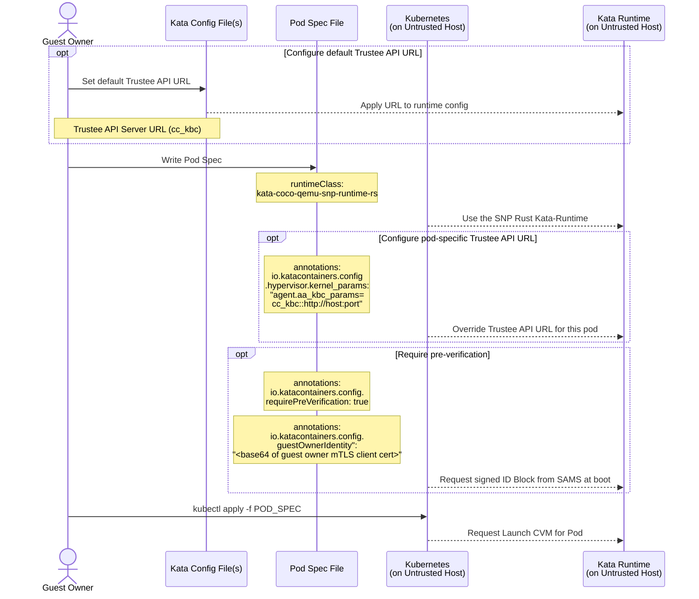
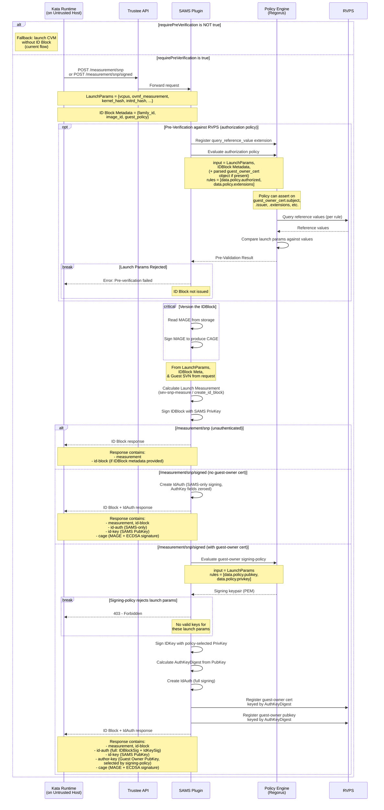
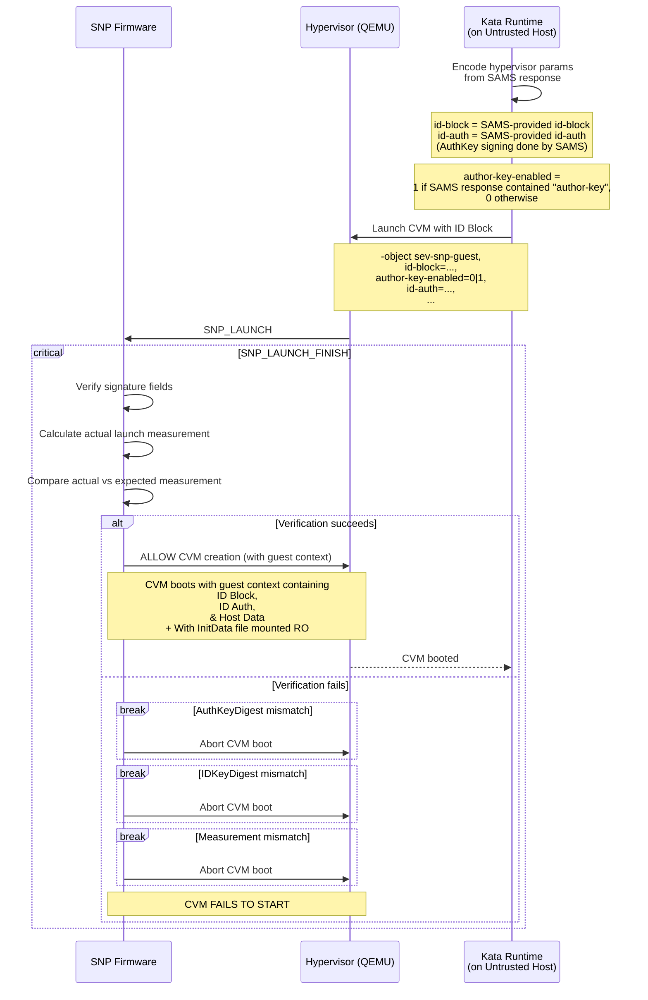
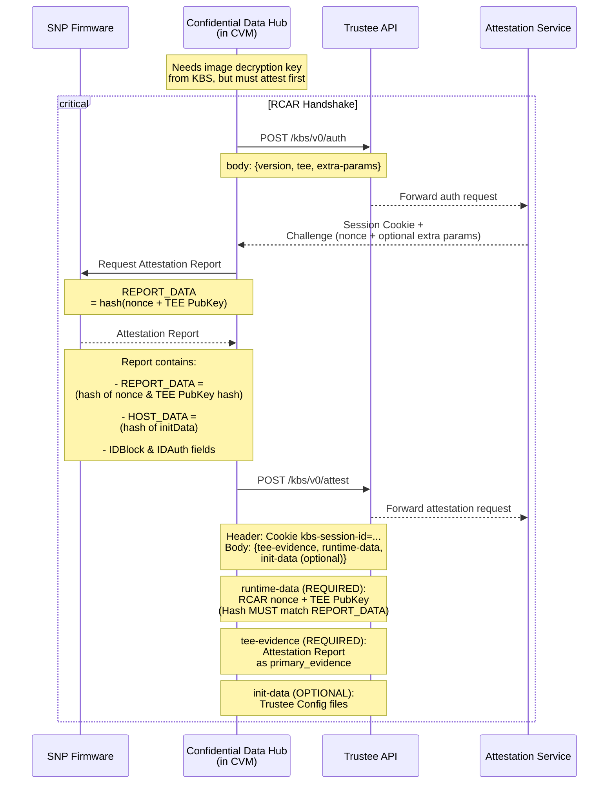
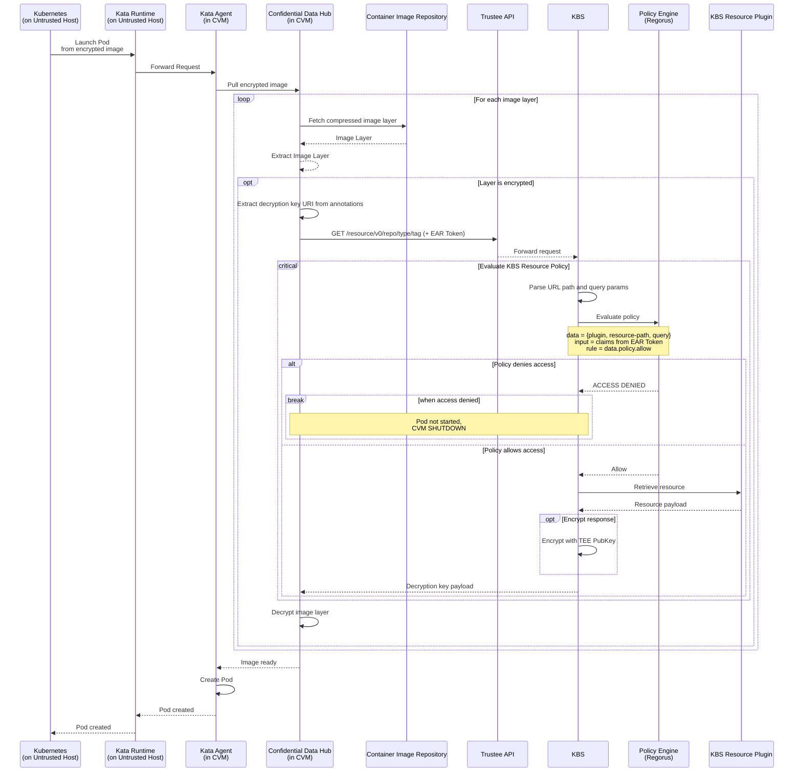

# Signing, Authorization, & Measurement Service (SAMS)

Background
---
Provides CVM-Launch-Measurement-as-a-Service functionalities.

Why?
---
1. Offers verifiers AS STRONG a guarantee that an attester launched with a specific configuration as does verifying the launch measurement in an attestation report against a list of reference values.
2. Makes Attestation Reports generated by Pre-Verified CVMs reflect an endorsement from Trustee
3. Facilitates the transition from storing and comparing opaque pre-computed launch measurements in RVPS to storing and comparing modular values for specific launch parameters

API
---

> For full request/response schemas see [Demystifying the Measurement Endpoints](demystifying-the-measurement-endpoints.md).
> For the signing-policy design rationale see [Addendum on Dynamic Auth Keys](addendum-on-dynamic-auth-keys.md).

### POST /authorization/policy
#### Description:
Admin sets the policy that gates ID Block issuance. Can also bump the MAGE counter (Measurement Audit Generation Epoch) to invalidate stale ID Blocks.
#### Requires Admin?
- Yes
#### Request Params:
- A JSON Object containing:
 ```json
 {
    "policy": "< base64-encoded rego policy >",
    "incr_mage": bool   //optional, default false
}
 ```

#### Request Response Body:
- OK,`{"mage": <MAGE value after operation: int>}`


#### Expected usage:

```shell
encoded_policy=$(base64 <<EOF
package policy
import rego.v1
default authorized := true
EOF)
payload="$(jq --args policy "$encoded_policy" '{"policy": $policy}')"

kbs_host=localhost
kbs_api_port=8080
curl -X POST \
    -H "Content-Type: application/json" \
    -d "$payload" \
    http://$kbs_host:$kbs_api_port/kbs/v0/sams/authorization/policy

# Expected response: '{"mage": 0}'
```

---

### GET /authorization/policy
#### Description:
Returns the current authorization policy and MAGE counter value.
#### Requires Admin?
- Yes
#### Response:
```json
{
    "policy": "<base64-encoded rego policy, or null if not set>",
    "mage": 0
}
```

---

### POST /measurement/\<tee\>/
#### Description:
Computes a launch measurement from CVM parameters. Optionally returns a signed ID Block if IDBlock metadata is included.
#### Requires Admin?
- No
#### Request Params:
- A JSON Object containing:
1. All params required to create a Launch Measurement (e.g. vcpus, vcpu_type, vmm_type, guest_features, append)
2. An `ovmf_measurement` field containing a base64-encoded `OvmfMeasurement` (produced by `get_snp_ovmf_measurement()` from the `sev` crate), plus optional precomputed hashes for kernel and initrd (e.g. kernel_hash_str, initrd_hash_str)
3. [Optional] IDBlock Metadata: FAMILY_ID, IMAGE_ID, GUEST_POLICY, GUEST_SVN

#### Response (progressive):
- **Launch params only:** `{"measurement": "<launch measurement>"}`
- **Launch params + IDBlock Metadata:** adds `"id-block"` (base64-encoded IDBlock containing the measurement, FAMILY_ID, IMAGE_ID, GUEST_POLICY, and GUEST_SVN from the request (defaults to 0))

---

### POST /measurement/\<tee\>/auth
#### Description:
Primary endpoint for Kata Runtime at CVM launch. Like `/measurement/<tee>/` but also evaluates the authorization policy and produces a signed IdAuth. With a guest-owner cert, evaluates their signing-policy for full AuthKey signing.
#### Requires Admin?
- No
#### Headers:
- `Authorization: Bearer <JWT containing "certificate": "<guest-owner client cert (PEM)>">`  _(optional)_
#### Request Params:
- Same as `POST /measurement/<tee>/`, but IDBlock Metadata (FAMILY_ID, IMAGE_ID, & GUEST_POLICY) is **required**
#### Response (progressive):
- **Launch params + IDBlock Metadata + SAMS authorization policy approval:**
  - `"measurement"`, `"id-block"` (as above)
  - `"id-auth"` (base64-encoded IdAuth with SAMS-only signing: AuthKey fields zeroed)
  - `"id-key"` (SAMS Public Key)
  - `"cage"` — a JSON object `{"mage": <current MAGE>, "signature": "<base64 ECDSA-SHA384 signature>"}` (the Signed Audit Generation Epoch)
- **All of the above + registered guest-owner client cert in Bearer Token:**
  - SAMS evaluates the guest-owner's **signing-policy** (a Rego policy uploaded during registration) with the launch params as input. The policy selects which signing keypair to use by outputting `data.policy.pubkey` and `data.policy.privkey` (PEM strings).
  - `"id-auth"` includes guest-owner signing (IdKeySig, AuthKeyAlgo, AuthKeyDigest populated using the policy-selected keys)
  - `"author-key"` (Guest Owner Public Key, as selected by the signing-policy)
  - The guest-owner's mTLS cert is appended to the RVPS `"guest-owner-certs"` list for the AuthKeyDigest of the policy-selected key (multiple guest-owners sharing a signing key are stored as separate entries under the same digest)
  - The guest-owner's public signing key is stored in the RVPS `"guest-owner-pubkeys"` map, keyed by AuthKeyDigest
#### Error Codes:
- `400` — missing required launch params or IDBlock metadata
- `401` — malformed/expired Bearer Token, invalid cert, or unknown guest-owner (no signing-policy registered)
- `403` — authorization policy rejects launch params, or signing-policy does not produce valid keys for these launch params

---

### GET /signing/identity-provider
#### Description:
Returns the URL of the Certificate Authority that issues mTLS client certificates for SAMS. Guest-owners use this to programmatically discover where to submit CSRs for obtaining mTLS certificates.
#### Requires Admin?
- No
#### Response:
```json
{"certificate_authority_url": "https://ca.example.com/v1/sign"}
```
#### Error Codes:
- `404` — identity provider URL is not configured and could not be derived from the mTLS CA certificate
#### How the URL is resolved:
1. If `identity_provider_url` is set in `SamsConfig`, that value is used directly
2. Otherwise, if `tls_client_ca_cert` is configured in the KBS TLS config, SAMS parses the CA certificate's Authority Information Access (AIA) extension and extracts the CA Issuers URL
3. If neither source provides a URL, the endpoint returns 404

---

### POST /signing/policy
#### Description:
Guest-owner registers a Rego signing-policy that maps launch params to signing keypairs. Private keys stay in Trustee.
#### Requires Admin?
- No (mTLS-authenticated via proxy)
#### Prerequisites:
- Connection must use mTLS, enforced by a TLS-terminating reverse proxy (e.g. nginx, envoy) that forwards the verified client certificate to SAMS via the `X-Client-Cert` header.
- KBS must be configured with `tls_client_ca_cert` pointing to the CA certificate, or a proxy must handle client cert verification.
#### Request Params:
```json
{
    "signing_policy": "<base64-encoded Rego policy>"
}
```
The Rego policy receives the launch params as `input` and must define two rules:
- `data.policy.pubkey` — a PEM-encoded EC public key string
- `data.policy.privkey` — a PEM-encoded EC private key string

This allows guest-owners to define multiple signing keypairs and have SAMS select the appropriate one based on the launch parameters provided to the `/measurement/<tee>/auth` endpoint.
#### Behavior:
- Decodes and validates the base64-encoded Rego policy
- Stores the signing-policy in SAMS internal storage, keyed by the SHA-384 hash of the guest-owner's mTLS client certificate

> **Note on cert rotation:** After rotating an mTLS certificate, guest-owners must re-register their signing-policy using the new certificate. A rotated cert is a new identity from SAMS' perspective. See [Addendum on Dynamic Auth Keys](addendum-on-dynamic-auth-keys.md) for details.
#### Expected usage:
```shell
encoded_policy=$(base64 <<'EOF'
package policy
import rego.v1

pubkey := "<PEM public key>"
privkey := "<PEM private key>"
EOF
)

curl \
    --cert guest-owner-client.crt \
    --key guest-owner-client.key \
    --cacert ca.crt \
    -X POST https://$kbs_host:$kbs_api_port/kbs/v0/sams/signing/policy \
    -H "Content-Type: application/json" \
    -d "{\"signing_policy\": \"$encoded_policy\"}"
```

> See [Addendum on Dynamic Auth Keys](addendum-on-dynamic-auth-keys.md) for the full design rationale.

---

### DELETE /signing/policy
#### Description:
Revokes the guest-owner's signing-policy and removes their cert from all RVPS endorsement lists.
#### Requires Admin?
- No (mTLS-authenticated via proxy)
#### Prerequisites:
- Connection must use mTLS (same proxy requirements as registration).
#### Behavior:
1. Extract the client cert from the `X-Client-Cert` header (set by the mTLS proxy)
2. Hash the client cert (SHA-384) and delete the guest-owner's signing-policy from SAMS storage
3. Remove the guest-owner's cert from all `"guest-owner-certs"` lists in RVPS (matching by certificate value), dropping any AuthKeyDigest entries whose list becomes empty
#### Expected usage:
```shell
curl \
    --cert guest-owner-client.crt \
    --key guest-owner-client.key \
    --cacert ca.crt \
    -X DELETE https://$kbs_host:$kbs_api_port/kbs/v0/sams/signing/policy
```

---

### DELETE /signing/key/\<base64(AuthKeyDigest)\>
#### Description:
Revokes a single signing-key endorsement from RVPS without touching the signing-policy.
#### Requires Admin?
- No (mTLS-authenticated via proxy)
#### Prerequisites:
- Connection must use mTLS (same proxy requirements as registration).
#### Behavior:
1. Base64-decode the AuthKeyDigest from the URL path
2. Look up the RVPS `"guest-owner-certs"` list for that AuthKeyDigest
3. If found, verify that the caller's mTLS client certificate is in the list (returns `403` if not present)
4. Remove the caller's cert from the list, dropping the AuthKeyDigest entry if the list becomes empty
5. If the AuthKeyDigest entry was fully removed, also remove the corresponding entry from `"guest-owner-pubkeys"` in RVPS
6. Return `200 OK` (idempotent: deleting a non-existent key also returns `200`)
#### Expected usage:
```shell
# Revoke a specific signing key endorsement
auth_key_digest_b64=$(echo -n "<hex-encoded AuthKeyDigest>" | base64)

curl \
    --cert guest-owner-client.crt \
    --key guest-owner-client.key \
    --cacert ca.crt \
    -X DELETE https://$kbs_host:$kbs_api_port/kbs/v0/sams/signing/key/$auth_key_digest_b64
```

---

##### SEV SNP ID-BLOCK Backend
The attestation flow using ID Block is broken into the following phases:

1. [Pod Configuration & Creation](#1-pod-configuration--creation)
2. [ID Block Generation via SAMS](#2-id-block-generation-via-sams)
3. [CVM Launch & Firmware Verification](#3-cvm-launch--firmware-verification)
4. [RCAR Handshake & Attestation Report](#4-rcar-handshake--attestation-report)
5. [Attestation Verification & Policy Evaluation](#5-attestation-verification--policy-evaluation)
6. [Secret Release & Pod Launch](#6-secret-release--pod-launch)

---

##### 1. Pod Configuration & Creation

The Guest Owner writes a Pod Spec selecting the SNP runtime class and optionally
enables pre-verification via SAMS. Kubernetes forwards the request to the Kata Runtime.



---

##### 2. ID Block Generation via SAMS

When `requirePreVerification` is true, Kata Runtime requests an ID Block from
the SAMS plugin. SAMS optionally pre-verifies each launch parameter against RVPS
reference values before computing the expected launch measurement and signing the
ID Block. SAMS reads the current Measurement Audit Generation Epoch (MAGE) and signs it to produce a CAGE
(Certified Audit Generation Epoch), which is returned alongside the ID Block so
that stale ID Blocks can be rejected during attestation.

If `requirePreVerification` is not true, the current (non-SAMS) flow is used and
the CVM is launched without an ID Block.

When the request targets the `/auth` endpoint and includes a Bearer Token with a
registered guest owner's client certificate, SAMS evaluates the guest owner's
**signing-policy** — a Rego policy uploaded during registration — with the launch
params as input. The policy selects which signing keypair to use, and SAMS signs
the IDKey with the selected private key, producing a full IdAuth with non-zero
AuthKey fields. The guest owner's mTLS certificate is then registered in RVPS,
keyed by the AuthKeyDigest of the selected key.

See [Addendum on Dynamic Auth Keys](addendum-on-dynamic-auth-keys.md) for the
full design rationale.

> **TODO** Need to update `sev` crate to verify `IDBlockSig` when provided an IDBlock & an IDKey (PubKey)
>> This facilitates allowing Kata-Runtime to confirm that the IDBlock, IDBlockSig, & IDKey SAMS returns actually match.
>> Note: This check already happens in the SNP Firmware, but for completeness sake this functionality should also be exposed in the `sev` crate.



---

##### 3. CVM Launch & Firmware Verification

Kata Runtime passes the SAMS-provided id-block and id-auth directly to the
hypervisor. When SAMS handled guest-owner authentication (via the `/auth`
endpoint), the id-auth already contains the full IdAuth with AuthKey signing
performed inside SAMS using the guest owner's signing-policy-selected key.
SNP firmware verifies the signatures and compares the actual launch measurement
against the expected value in the ID Block.



---

##### 4. RCAR Handshake & Attestation Report

Once the CVM is running, the Confidential Data Hub (CDH) needs secrets (e.g. image
decryption keys) from the KBS. It performs the RCAR handshake in three steps: first,
it authenticates via `POST /kbs/v0/auth` and receives a session cookie and challenge
nonce. Next, it requests an attestation report from SNP firmware, binding the nonce
and TEE public key into REPORT_DATA. The resulting report also carries the HOST_DATA
set at launch, along with the IDBlock and IDAuth fields. Finally, CDH submits the
report to `POST /kbs/v0/attest` with the tee-evidence (the attestation report),
runtime-data (the nonce and TEE public key whose hash must match REPORT_DATA),
and optionally init-data.



---

##### 5. Attestation Verification & Policy Evaluation

The SNP Verifier validates the attestation report in three stages: first, it verifies the
AMD certificate chain (hardware endorsement); second, it checks that the hashes of the
provided initdata and runtimedata match the HOST_DATA and REPORT_DATA fields in the report.
The verifier now extracts additional claims from the report: `id_block_en`,
`id_key_digest`, `author_key_digest`, `author_key_en`, `family_id`, `image_id`,
and `guest_svn`. `id_block_en` is a derived boolean that is `true` when the
report's `id_key_digest` is not all zeros.

Before policy evaluation, when `id_block_en` is `true`, the EAR token broker verifies
SAMS key endorsement by retrieving the SAMS IDKey public key (`"sams-id-key"`) from RVPS,
computing its SHA-384 digest, and comparing it against the `id_key_digest` claim from the
report. If `author_key_en` is true,
the broker also checks whether the `author_key_digest` exists in the `"guest-owner-pubkeys"`
map in RVPS. The results are injected as `sams_id_key_endorsed` and `author_key_endorsed`
boolean claims, available to the policy engine for trust decisions.

When `author_key_en` is true, the broker also retrieves the guest-owner's mTLS
certificates from RVPS (`"guest-owner-certs"` list for the matching AuthKeyDigest), parses
each PEM certificate into a structured JSON object, and injects them as `guest_owner_certs`
in the claims. Each cert object contains `subject`, `issuer`, `serial`, `not_before`,
`not_after`, and `extensions` (including `subject_alt_names`) — allowing policies to make
assertions like `input.guest_owner_certs[i].subject.O == "Acme Corp"`.

The verified claims are then evaluated by the Policy Engine against the EAR appraisal policy.
Policy provisions can query RVPS for reference values, verify the CAGE signature against the
SAMS public key and compare the MAGE against the current minimum in RVPS, check the
`sams_id_key_endorsed` and `author_key_endorsed` flags, and assert on the structured
`guest_owner_certs`. Any mismatch adjusts the trust claims at a severity determined by the
Verifier Policy Owner. The final
result is an EAR token encoding the TEE's trustworthiness vector.

The default EAR policy (`ear_default_policy_cpu.rego`) now includes a SAMS-specific
SNP rule that requires `id_block_en`, `sams_id_key_endorsed`, `author_key_endorsed`,
and a valid CAGE with MAGE at or above the RVPS minimum for an `executables` score of 3.

```mermaid
sequenceDiagram
    participant cdh as Confidential Data Hub<br>(in CVM)
    participant snp_verifier as SNP Verifier
    participant policy_engine as Policy Engine<br>(Regorus)
    participant rvps as RVPS

    critical Verify hardware endorsements
        snp_verifier ->> snp_verifier: Verify AMD certificate chain
        break Signature mismatch
            note over snp_verifier: Report not trusted<br>by HW manufacturer
        end
    end

    critical Verify user-defined report fields
        snp_verifier ->> snp_verifier: Hash provided initdata & runtimedata
        snp_verifier ->> snp_verifier: Compare against HOST_DATA<br>& REPORT_DATA in report
        break initdata hash mismatch
            note over snp_verifier: CVM may be in a<br>non-compliant state
        end
        break runtimedata hash mismatch
            alt Nonce mismatch
                note over snp_verifier: Potential replay attack
            else TEE PubKey mismatch
                note over snp_verifier: Potential MITM attack
            end
        end
    end

    critical Verify SAMS key endorsement (EAR broker)
        note over snp_verifier, rvps: Before policy evaluation, the EAR<br>token broker checks key endorsement
        snp_verifier ->> rvps: query_reference_value("sams-id-key")
        rvps -->> snp_verifier: SAMS IDKey pubkey (base64)
        snp_verifier ->> snp_verifier: SHA-384(pubkey bytes)<br>== id_key_digest?
        note over snp_verifier: Inject sams_id_key_endorsed<br>into claims

        opt author_key_en is true
            snp_verifier ->> rvps: query_reference_value("guest-owner-pubkeys")
            rvps -->> snp_verifier: AuthKeyDigest -> pubkey map
            snp_verifier ->> snp_verifier: author_key_digest in map?
            note over snp_verifier: Inject author_key_endorsed<br>into claims

            snp_verifier ->> rvps: query_reference_value("guest-owner-certs")
            rvps -->> snp_verifier: AuthKeyDigest -> cert list
            snp_verifier ->> snp_verifier: Parse PEM certs into<br>structured JSON objects
            note over snp_verifier: Inject guest_owner_certs<br>into claims (subject, issuer,<br>serial, validity, extensions)
        end
    end

    critical Evaluate appraisal policy
        snp_verifier ->> policy_engine: Register query_reference_value extension
        snp_verifier ->> policy_engine: Evaluate EAR policy for TEE class
        note over snp_verifier, policy_engine: input = claims from report<br>(incl. sams_id_key_endorsed,<br>author_key_endorsed,<br>guest_owner_certs,<br>guest_svn, family_id, image_id)<br>rules = [data.policy.trust_claims,<br>data.policy.extensions]

        loop For each policy provision
            opt Provision queries reference values
                policy_engine ->> rvps: Retrieve reference values
                rvps -->> policy_engine: Reference values
                policy_engine ->> policy_engine: Compare claims against values
            end
        end

        opt Verify CAGE / MAGE
            policy_engine ->> policy_engine: Verify CAGE signature against SAMS public key
            policy_engine ->> rvps: Retrieve current MAGE minimum
            rvps -->> policy_engine: MAGE minimum value
            policy_engine ->> policy_engine: Compare CAGE MAGE against minimum
            break CAGE invalid or MAGE below minimum
                policy_engine ->> policy_engine: Adjust trust claims
                note over policy_engine: Severity determined by<br>Verifier Policy Owner
            end
        end

        opt Check SAMS endorsement
            policy_engine ->> policy_engine: Check sams_id_key_endorsed
            break sams_id_key_endorsed is false
                policy_engine ->> policy_engine: Adjust trust claims
            end
        end

        opt Check Guest Owner endorsement
            policy_engine ->> policy_engine: Check author_key_endorsed
            break author_key_endorsed is false
                policy_engine ->> policy_engine: Adjust trust claims
            end
        end

        opt Assert on Guest Owner identity (certs)
            policy_engine ->> policy_engine: Assert on guest_owner_certs<br>(subject, issuer, extensions, etc.)
            break Guest-owner cert assertion fails
                policy_engine ->> policy_engine: Adjust trust claims
            end
        end

        policy_engine -->> snp_verifier: Trust claims (map of i8 integers)
        snp_verifier ->> snp_verifier: Convert to AR4SI Trustworthiness Vector
    end

    critical Issue EAR Token
        snp_verifier ->> snp_verifier: Create JWT bound to HTTP session
        note over snp_verifier: Contains: trustworthiness vector,<br>expiration (default TTL: 5 min)
        snp_verifier -->> cdh: EAR Token (RCAR handshake complete)
    end
```



---

##### 6. Secret Release & Pod Launch

The CDH presents the EAR token to request resources from the KBS. The KBS evaluates
the token against its resource policy; if allowed, the secret is released (optionally
encrypted with the TEE's public key). The CDH decrypts image layers and the pod launches.



Design Documents
---
- [Demystifying the Measurement Endpoints](demystifying-the-measurement-endpoints.md) — detailed request/response schemas for `/measurement/snp` and `/measurement/snp/signed`
- [Addendum on Dynamic Auth Keys](addendum-on-dynamic-auth-keys.md) — guest-owner signing-policy, mTLS proxy authentication, and dynamic AuthKey signing design
- [Improvements & Open Questions](IMPROVEMENTS.md) — tracked improvements and open design questions
